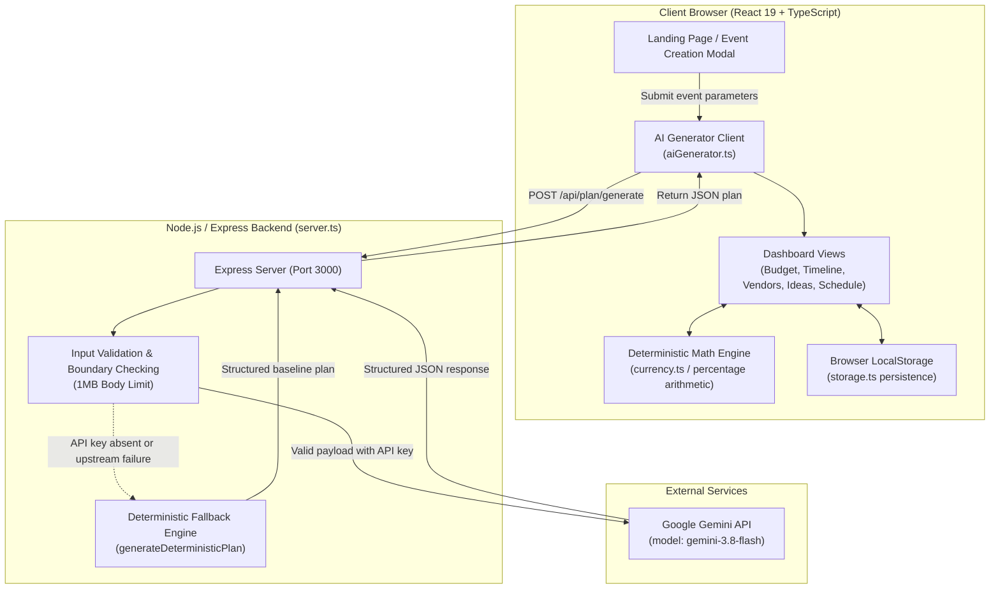

# CelebrAI Architecture

## 1. Overview

CelebrAI is an intelligent celebration and event planning web application designed to help hosts organize weddings, birthdays, and community gatherings. The application takes high-level celebration parameters—such as event type, target date, guest count, financial budget, and personal preferences—and converts them into a structured planning workspace. 

The system pairs generative AI via Google Gemini for creative ideation, structured milestone planning, and vendor requirement drafting with deterministic application logic for arithmetic precision, budget allocation tracking, and client-side session persistence.

---

## 2. High-Level Architecture

CelebrAI operates as a full-stack web application hosted on a single Node.js runtime. The architecture cleanly separates presentation, API orchestration, AI generation, and calculation logic:

- **Frontend (Client):** A single-page application built with React 19, TypeScript, and Tailwind CSS. It handles user interactions, renders the public landing page and interactive planning views, performs deterministic budget calculations, and persists state in browser `localStorage`.
- **Backend (Server):** A Node.js and Express service (`server.ts`) that manages API routes, parses and validates incoming payloads, proxies requests to Google Gemini, and hosts a deterministic fallback planning engine. In production, the server also serves the compiled static Vite frontend bundle.
- **AI Integration:** Google Gemini (`gemini-3.8-flash`) accessed via the official `@google/genai` TypeScript SDK on the server side using structured JSON schemas.
- **Deterministic Math Layer:** A dedicated TypeScript helper layer that guarantees mathematical consistency for budgets, category percentages, and remaining funds without relying on LLM arithmetic.
- **Persistence Layer:** Client-side browser `localStorage` with defensive deserialization to retain event plans across page reloads.

### Architectural Diagram



---

## 3. Frontend Architecture

The frontend is constructed using modular, functional React components with standard React state hooks (`useState`, `useEffect`) and typed interfaces.

### Application Routing & Views

The top-level controller (`src/App.tsx`) manages primary view switching between:
1. **Public Landing Page (`src/components/landing/`):** The introductory entry point presenting product capabilities, value propositions, interactive feature highlights, and direct entry points to plan an event or explore a pre-populated celebration.
2. **Event Setup Modal (`src/components/planner/CreateEventModal.tsx`):** A step-based modal capturing event name, celebration type, date, location, guest count, currency, total budget, styling preferences, dietary needs, accessibility considerations, and priorities.
3. **Application Workspace (`src/components/layout/`):** When in the app view, a top navigation header (`Header.tsx`) and responsive sidebar (`Sidebar.tsx`) coordinate navigation across dedicated functional tabs:
   - **Dashboard Overview (`src/components/dashboard/DashboardView.tsx`):** High-level summary displaying overall planning progress, budget health indicators, upcoming milestone alerts, and key event parameters.
   - **Smart Budget (`src/components/budget/BudgetView.tsx`):** Category-based financial allocation table. Hosts can add custom expense items, edit allocations, remove categories, and view real-time remaining balances with automated over-budget alerts.
   - **Chronological Timeline (`src/components/timeline/TimelineView.tsx`):** Milestone checklist organized from pre-event planning phases to event week. Tasks feature priority flags (High, Medium, Low) and completion toggles.
   - **Vendor Checklist (`src/components/vendors/VendorsView.tsx`):** Status tracking pipeline for vendor categories (Venue, Catering, Decor, Photography, AV, Entertainment). Supports transition through four stages (*To Contact*, *Contacted*, *Shortlisted*, *Booked*) and includes persistent notes for quotes and contacts.
   - **Personalized Ideas (`src/components/ideas/IdeasView.tsx`):** Creative suggestions across themes, catering, entertainment, and guest experiences with contextual rationales ("Why it fits your celebration"). Includes a button to regenerate fresh concepts on demand.
   - **Event-Day Run-of-Show (`src/components/schedule/ScheduleView.tsx`):** Chronological, hour-by-hour itinerary for event day covering vendor load-in, guest welcome, main ceremonies, meal service, and load-out, with inline item addition and completion tracking.
   - **Settings & Templates (`src/components/settings/EventSettingsView.tsx`):** Allows switching between saved events, resetting data, or loading pre-built celebration templates (wedding, milestone birthday, community gathering).

---

## 4. Backend Architecture

The backend is implemented as an Express application in `server.ts`. It acts as an API proxy and application server:

### Server Entry Point
- Initialized via `server.ts`.
- Evaluates `process.env.NODE_ENV` to serve either Vite development middleware or production static assets from the `dist/` directory.
- Listens on `process.env.PORT` (defaults to `3000`).

### Active API Endpoints
- **`GET /api/health`**: Returns system status, timestamp, and a boolean indicator (`aiConfigured`) verifying whether `GEMINI_API_KEY` is loaded and ready.
- **`POST /api/plan/generate`**: Accepts event parameters, performs schema validation, prompts `gemini-3.8-flash` for a complete structured plan, sanitizes the response, and returns the result. If the Gemini API is unreachable or unconfigured, it seamlessly routes to the deterministic fallback engine.
- **`POST /api/ideas/regenerate`**: Accepts an existing event's context and generates a fresh set of creative ideas with rationales, either via Gemini or via local fallback recommendations.

### Request Validation & Payload Limits
- Express body parsing middleware enforces a strict `1mb` limit (`express.json({ limit: '1mb' })`).
- Payload boundaries are explicitly checked before downstream handling:
  - Event names must be non-empty strings under 120 characters.
  - Guest counts must be numeric values between 1 and 50,000.
  - Total budget must be a positive number between 100 and 1,000,000,000.
  - String fields are trimmed and sanitized against malformed types.

### Error Handling & Status Codes
- Invalid request payloads return clean `400 Bad Request` JSON responses with specific error descriptions.
- Upstream AI errors or unhandled exceptions are caught in `try/catch` blocks and gracefully fall back to local planning plans rather than crashing or returning blank errors to the client.

---

## 5. AI Integration

CelebrAI utilizes the modern Google Gen AI SDK (`@google/genai`) to integrate generative intelligence into event planning:

- **Model Specification:** `gemini-3.8-flash`.
- **System Instructions:** Configured to enforce realistic, structured, budget-conscious event planning data without conversational markdown wrappers.
- **Structured JSON Output:** Uses `responseMimeType: 'application/json'` along with `responseSchema` (using SDK `Type.OBJECT` and `Type.ARRAY` definitions) to guarantee that Gemini returns strictly typed data matching `GeneratedPlanData`.
- **Server-Side API Key Management:** The `GEMINI_API_KEY` is read from server environment variables and initialized strictly within `server.ts`. The API key is never exposed to the client or embedded in client-side bundles.
- **Information Sent to the Model:**
  - Event title, celebration type, date, location.
  - Expected guest count and total budget with selected currency.
  - Styling/theme preferences, dietary needs, accessibility needs, and planning priorities.
- **Generated Information:**
  - Executive event overview and personalized concept statement.
  - 4 to 6 category budget allocations with percentage breakdown and explanations.
  - 4 to 6 chronological planning milestones with target deadlines and priority levels.
  - 4 to 6 vendor requirement profiles with estimated costs and scopes.
  - 4 to 6 tailored creative ideas across themes, food, decor, and guest experience with rationales.
  - A full event-day run-of-show schedule.
  - Host execution tips.

---

## 6. Data Flow

```
[User Input in UI]
       │
       ▼
[Frontend: aiGenerator.ts] ──> Sends POST /api/plan/generate
       │
       ▼
[Backend: server.ts] ────────> 1. Validates body object and numeric bounds
       │                       2. Sanitizes input strings
       │
       ├───> [Gemini API] (if GEMINI_API_KEY present)
       │         │
       │         ▼
       │     Returns structured JSON matching responseSchema
       │
       └───> [Deterministic Fallback Engine] (if API key omitted or error occurs)
                 │
                 ▼
             Computes category distribution based on event type & budget
       │
       ▼
[Backend Normalization] ─────> Assigns stable unique IDs and verifies fields
       │
       ▼
[Frontend Response Handler] ─> Formats active EventPlan object
       │
       ├───> [Deterministic Math Engine] Recalculates remaining funds and totals
       │
       ├───> [LocalStorage] Persists event plan to browser storage
       │
       ▼
[Interactive Dashboard] ─────> Renders responsive views for budget, timeline, vendors, and schedule
```

---

## 7. Security Considerations

The application implements defense-in-depth security appropriate for a web prototype:

- **Server-Side Secret Isolation:** `GEMINI_API_KEY` is strictly held on the server and loaded via `process.env`. No API keys or tokens are passed to or stored in client-side code.
- **Zero Committed Secrets:** Repository `.gitignore` rules prevent `.env` and credential files from being tracked. Only `.env.example` with non-secret placeholders is committed.
- **Request Size Restriction:** Express request body limit is restricted to `1mb` to prevent memory exhaustion and payload abuse.
- **Server-Side Boundary Validation:** All incoming fields are validated on the server for length, data type, and logical numeric ranges before any AI or business processing.
- **Safe JSON Deserialization:** Local storage readers wrap JSON operations in defensive `try/catch` handlers with fallback states to protect against client storage corruption.
- **Safe Output Rendering:** React's built-in JSX escaping prevents Cross-Site Scripting (XSS) when rendering dynamic text generated by AI or entered by users.

### Explicit Scope Boundaries
- **No User Accounts / Auth:** The application currently runs as a single-user client session without user authentication (OAuth, JWT, or passwords).
- **No Remote Database:** Data is stored in the user's browser `localStorage` rather than an authenticated multi-tenant database.

---

## 8. Reliability and Fallback Behavior

A core architectural pillar of CelebrAI is graceful degradation:

1. **Deterministic Fallback Engine (`generateDeterministicPlan`):**
   If the Gemini API is unconfigured, rate-limited, or temporarily unreachable, `server.ts` routes the request to an internal planning generator. This engine uses pre-defined, event-specific budget distributions (e.g. 35% catering, 30% venue for weddings; 40% refreshments, 25% venue for birthdays) to generate a complete, coherent plan matching the user's requested budget and guest count.
2. **Deterministic Ideas Engine:**
   Similarly, the ideas endpoint provides structured celebratory concepts if the AI service cannot be reached.
3. **Transparent Execution Mode:**
   The backend returns a `source: 'gemini' | 'demo'` flag in its response, allowing the client to indicate planning mode without disrupting the host's workflow.

---

## 9. Deployment Architecture

CelebrAI is deployed as a single Web Service on **Render**:

```
GitHub Repository (main branch)
       │
       ▼
Render Web Service (Node.js Environment)
       │
       ├─ Build Phase: npm install && npm run build
       │   └─ Compiles TypeScript & bundles client via Vite into dist/
       │
       └─ Start Phase: npm start (node --loader tsx server.ts)
           └─ Serves Express backend API and static frontend assets
```

- **Hosting Platform:** Render Web Service.
- **Deployment URL:** `https://celebrai-event-planner-4f9e.onrender.com/`
- **Source Code Repository:** `https://github.com/souvikpal77/celebrai-event-planner`
- **Environment Configuration:** `GEMINI_API_KEY` is configured in the Render service environment settings.
- **Cold-Start Characteristic:** Because it operates on a free-tier instance, initial requests after periods of dormancy may take 40–50 seconds to spin up, after which responses operate with standard latency.

---

## 10. Project Structure

```
celebrai-event-planner/
├── .env.example              # Template for environment variables (GEMINI_API_KEY, PORT)
├── .gitignore                # Excludes node_modules, dist, and local .env files
├── ARCHITECTURE.md           # System architecture and technical design documentation
├── index.html                # Application entry HTML with fonts and metadata
├── LICENSE                   # Standard MIT License
├── metadata.json             # AI Studio applet manifest
├── package.json              # Package manifest and npm scripts (dev, build, start, lint)
├── README.md                 # Public repository documentation and user guide
├── server.ts                 # Express backend, Gemini API proxy, and fallback engine
├── tsconfig.json             # TypeScript compiler settings
├── vite.config.ts            # Vite bundler configuration and React plugin setup
└── src/
    ├── App.tsx               # Main application controller, view routing, and state sync
    ├── main.tsx              # React DOM initialization
    ├── index.css             # Tailwind CSS imports and global styling rules
    ├── components/
    │   ├── budget/           # Budget table, category adder, and progress summaries
    │   ├── dashboard/        # Dashboard overview cards and event stats
    │   ├── ideas/            # Personalized idea cards and regeneration controls
    │   ├── landing/          # Public landing page with feature sections and hero
    │   ├── layout/           # App header, responsive sidebar, and footers
    │   ├── plan/             # Event plan overview and parameter inspectors
    │   ├── planner/          # CreateEventModal and event configuration inputs
    │   ├── schedule/         # Day-of run-of-show hourly itinerary view
    │   ├── settings/         # Event switching, data reset, and template loader
    │   ├── timeline/         # Chronological milestones with priority and toggles
    │   └── vendors/          # Vendor checklist and 4-stage pipeline tracker
    ├── types/
    │   └── event.ts          # Shared TypeScript interfaces for events, tasks, budgets
    └── utils/
        ├── aiGenerator.ts    # Frontend HTTP client for server planning endpoints
        ├── currency.ts       # Deterministic math and multi-currency formatting
        └── storage.ts        # Type-safe localStorage reader and persistence helpers
```

---

## 11. Design Principles

1. **Separation of Concerns:** Client code is responsible for user interaction, layout, and reactive updates; the backend is responsible for API routing, validation, and AI coordination.
2. **Deterministic Arithmetic for Critical Numbers:** Budget totals, category percentages, spent allocations, and remaining balances are computed through deterministic TypeScript calculations rather than relying on LLM-generated math.
3. **AI as an Assistant, Not an Authority:** Generative AI is utilized for contextual ideation, milestone drafting, and descriptive breakdowns. All generated items remain fully editable by the human host.
4. **Resilient Failure Modes:** The application is architected to remain functional even when external AI APIs encounter network failures or rate limits, utilizing an integrated deterministic fallback generator.
5. **Simplicity and Maintainability:** Built with modular components, explicit TypeScript type contracts, and zero external database dependencies for local execution.

---

## 12. Known Limitations

- **No Multi-User Authentication:** The current version does not feature user authentication or login sessions.
- **Client-Side Persistence:** Event data is stored in the host's browser `localStorage`, meaning plans are scoped to the individual browser and device.
- **Planning Estimates:** Budget allocations, vendor pricing, and milestone durations generated by the AI are planning guidelines and do not constitute binding market quotes.
- **No Transactional Payments:** CelebrAI is a planning coordination tool; it does not process payments or contractually book vendors.

---

CelebrAI demonstrates how generative AI can be coupled with deterministic application logic to provide intuitive, practical event planning assistance.
